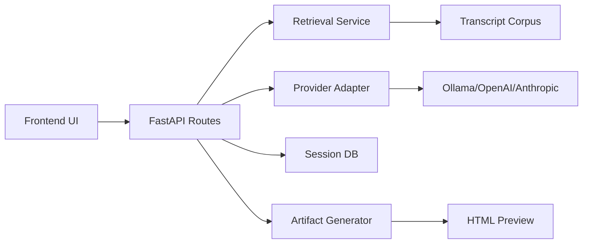

# Architecture Overview

## System boundary
The project is a small full-stack application with a Python FastAPI backend and a React + TypeScript frontend. The backend owns retrieval, provider orchestration, persistence, and artifact generation. The frontend renders the chat experience and previews generated outputs.

## Core components
- API layer: session and chat routes.
- Retrieval layer: source search and evidence ranking.
- Provider layer: Ollama, OpenAI, Anthropic provider adapters.
- Persistence layer: SQLAlchemy models and local SQLite by default.
- Artifact layer: content generation and preview rendering.

## Request flow
1. Frontend submits a user prompt.
2. API creates or loads a session.
3. Retrieval service searches transcript chunks.
4. Provider model generates an answer using retrieved evidence.
5. Response is persisted and returned to the frontend.
6. Artifact generation optionally produces markdown or HTML.

## Data model
- Conversation: top-level session container.
- Message: user or assistant content with role metadata.
- TranscriptSource: metadata for the original source.
- TranscriptChunk: searchable snippet content.
- Artifact: generated output and metadata.

## Security notes
- The app avoids raw JSON-to-HTML injection in the main application.
- Artifact previews are rendered in an iframe with safe defaults.
- The repo intentionally uses environment variables for model secrets and never stores credentials in source files.

## Deployment options
- Local dev: SQLite + Vite dev server + FastAPI reload.
- Docker compose: PostgreSQL + Ollama service stack for local demo.
- Production path: containerized backend and frontend behind a reverse proxy or unified service layer.
